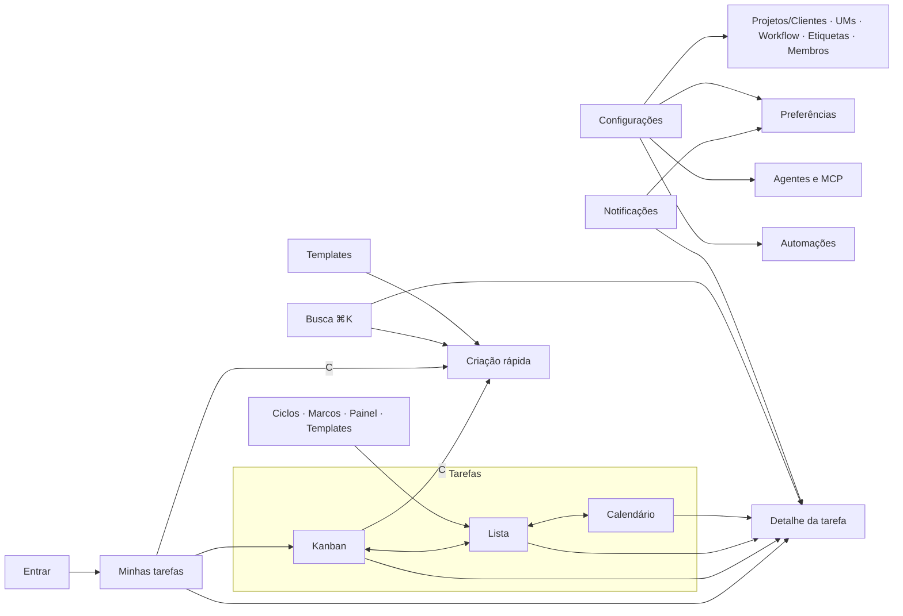
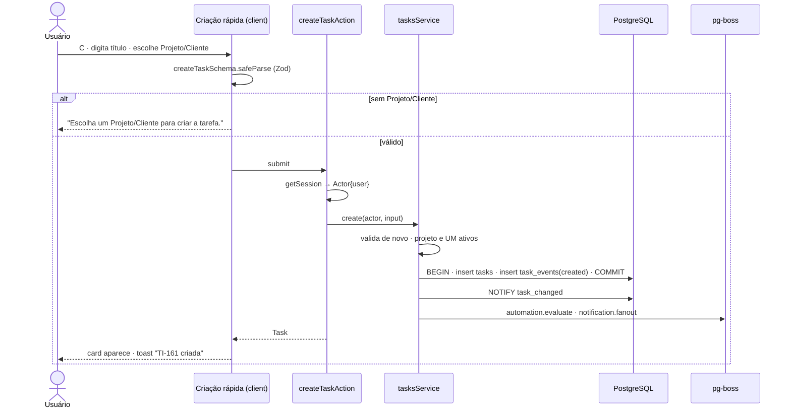
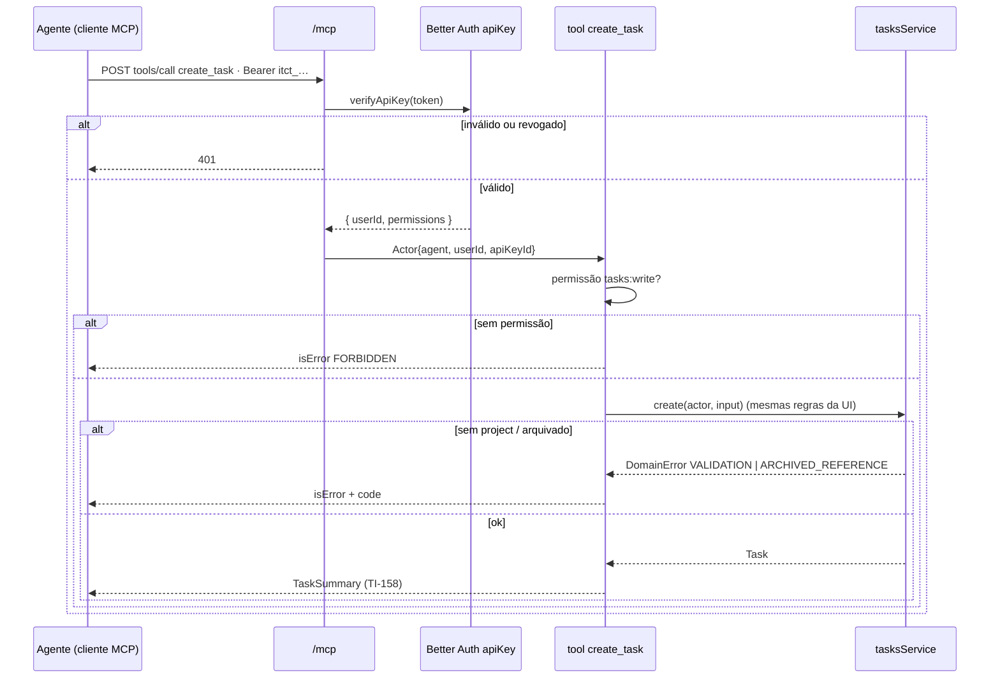
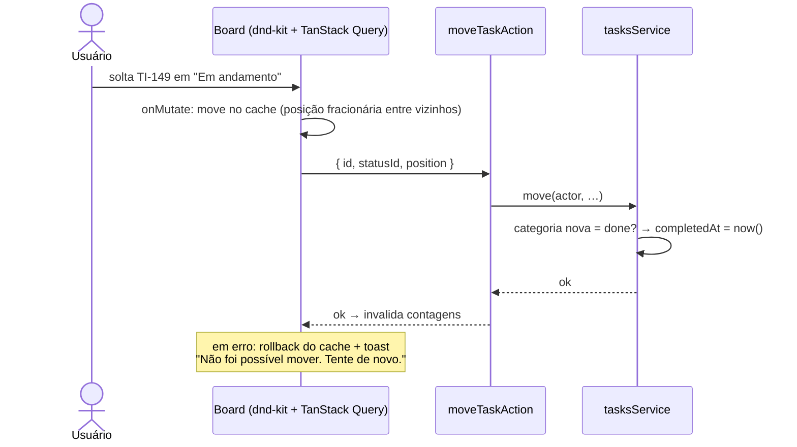
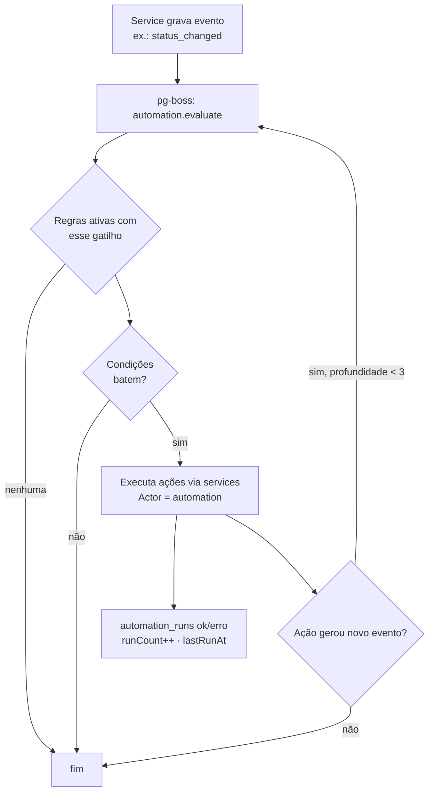
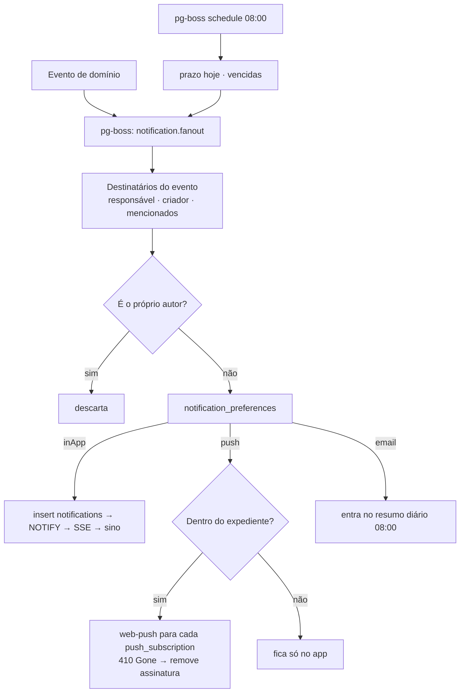
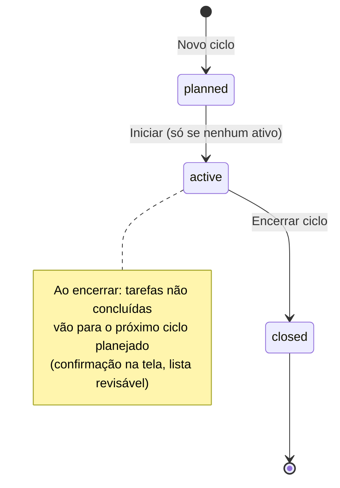
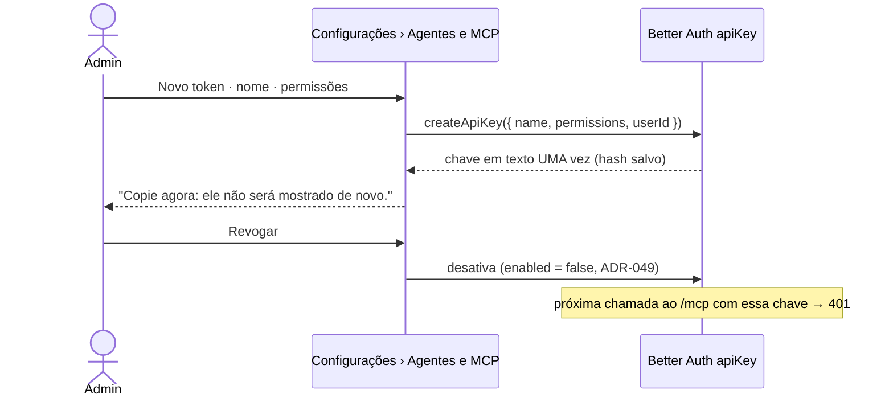
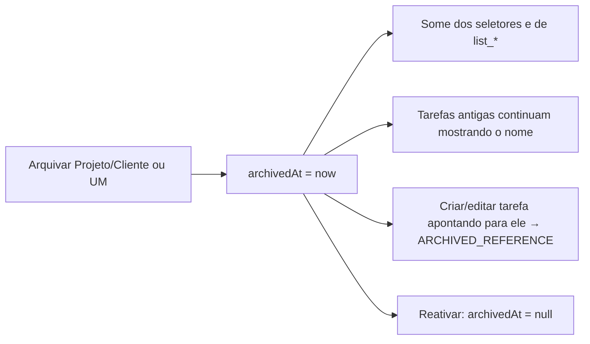

# ITC Tasks — Fluxos do app

> Estado: **planejado** (17/10/2026). Diagramas em Mermaid; renderizam no GitHub.
> Telas citadas: https://claude.ai/artifact/QeYVvyV9Ri2rAK3AydBap9

## 1. Mapa de navegação

## 2. Criar tarefa pela tela

## 3. Agente cria/atualiza tarefa via MCP

Toda chamada de escrita bem-sucedida gera `task_events` com `actorKind = 'agent'` e aparece
com o selo "via MCP" no histórico e na atividade de agentes.

## 4. Mover card no Kanban (atualização otimista)

## 5. Automação

Proteção contra laço: cada job carrega `depth`; acima de 3 a cadeia para e registra erro em
`automation_runs`.

## 6. Notificações

## 7. Ciclo de vida de um ciclo

## 8. Login e token de agente

## 9. Arquivar cadastro

