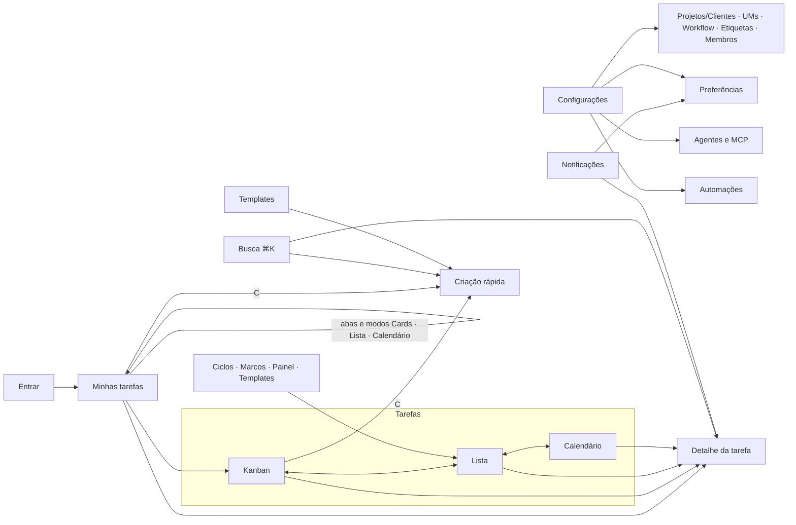
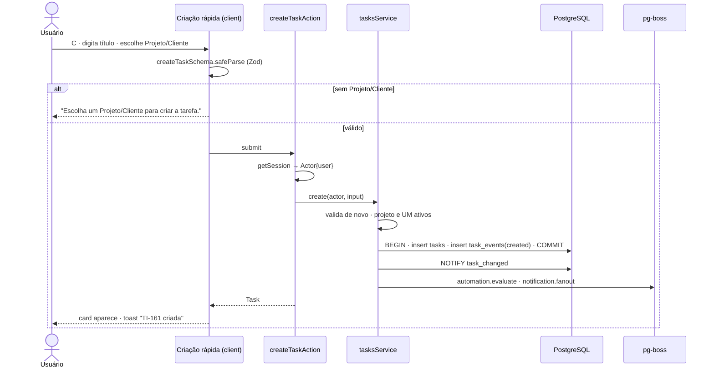
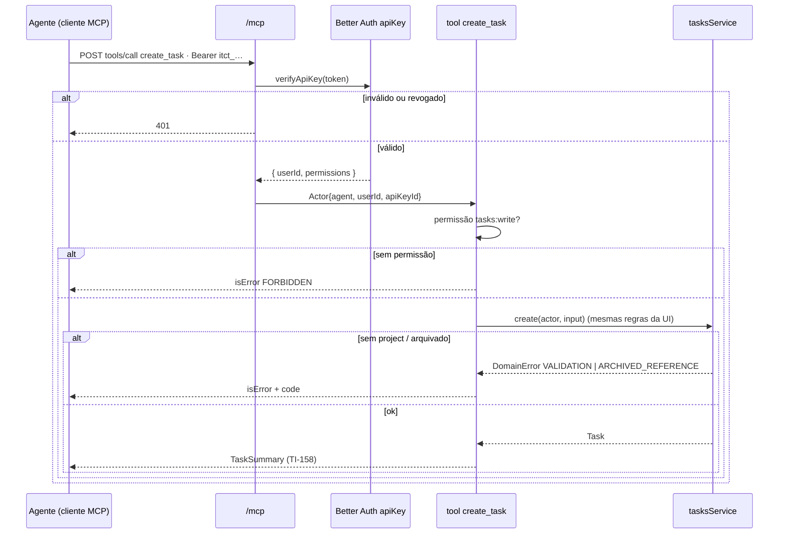
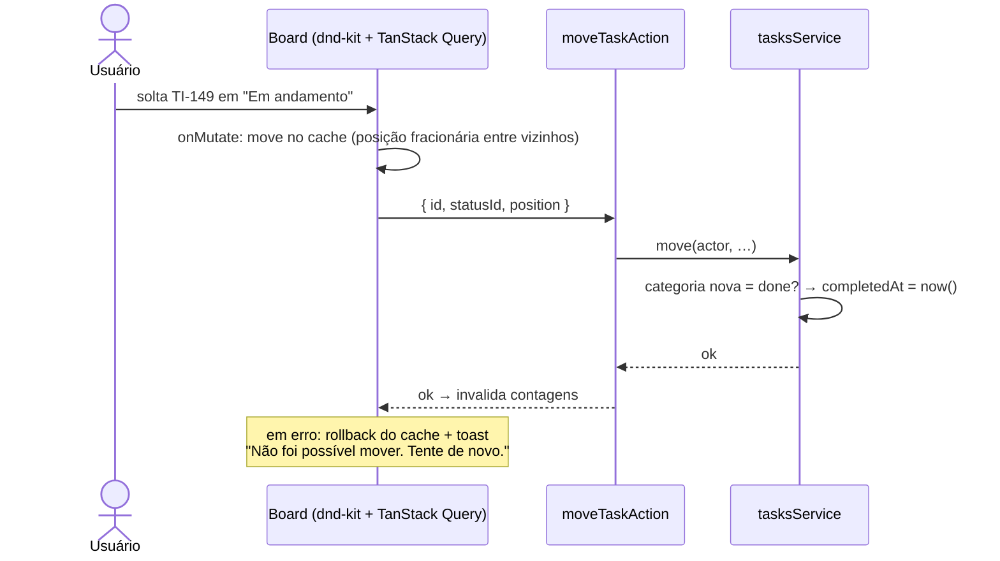
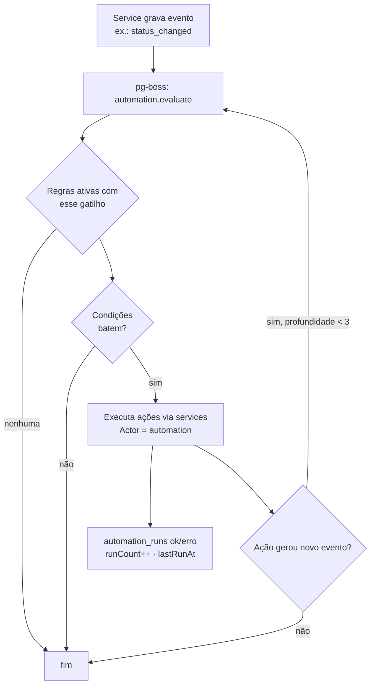
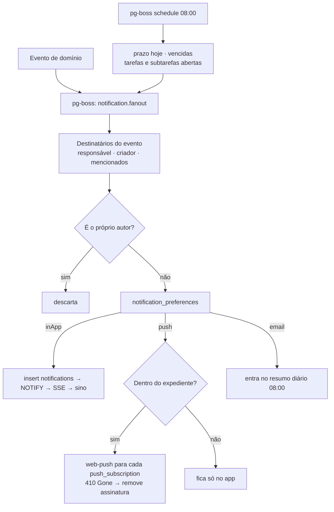
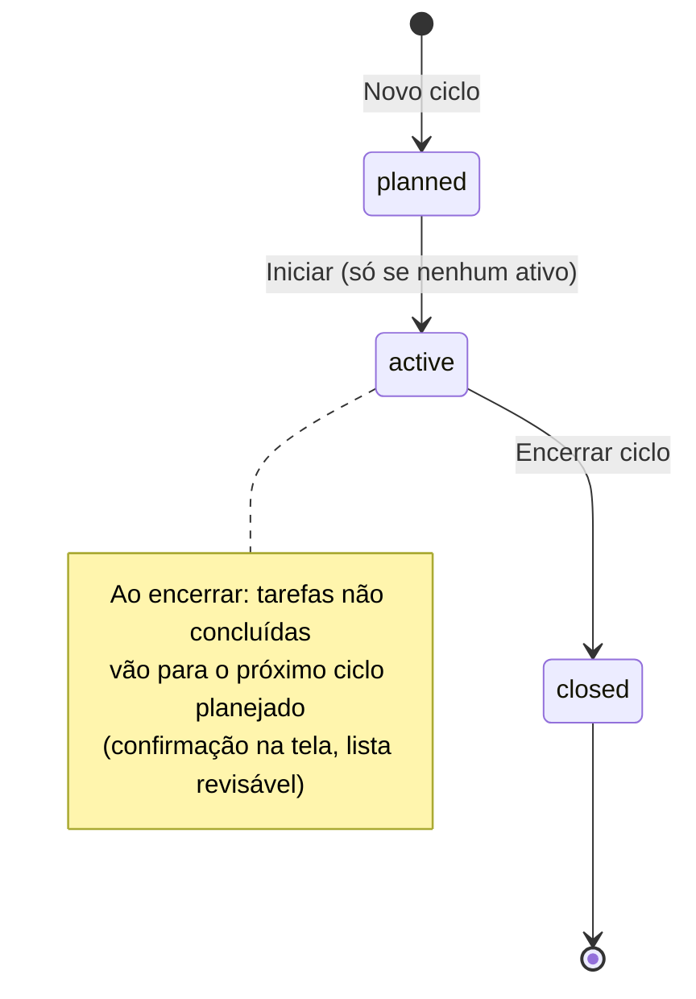
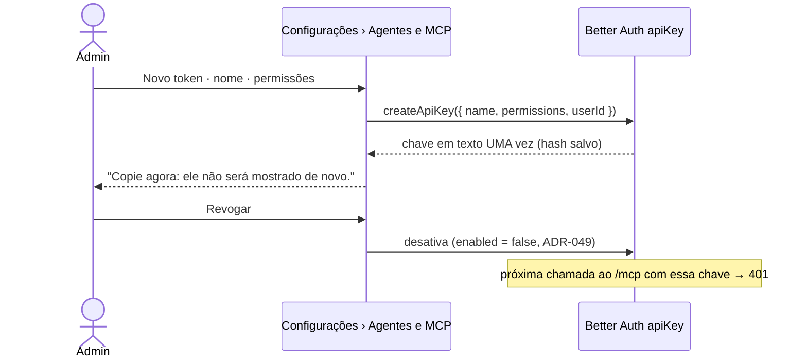
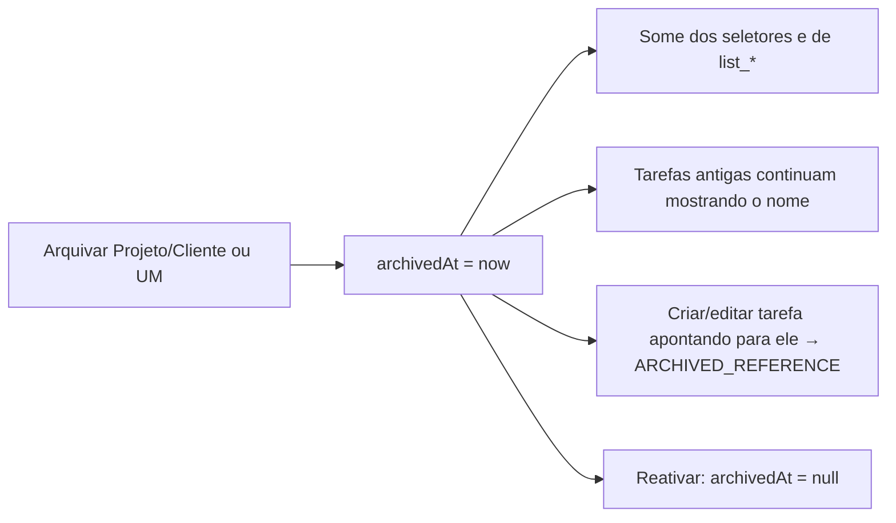

# ITC Tasks — Fluxos do app

> Estado: **planejado** (17/10/2026). Diagramas em Mermaid; renderizam no GitHub.
> Telas citadas: https://claude.ai/artifact/QeYVvyV9Ri2rAK3AydBap9

## 1. Mapa de navegação



## 2. Criar tarefa pela tela



## 3. Agente cria/atualiza tarefa via MCP



Toda chamada de escrita bem-sucedida gera `task_events` com `actorKind = 'agent'` e aparece
com o selo "via MCP" no histórico e na atividade de agentes.

## 4. Mover card no Kanban (atualização otimista)



Soltar em "Aguardando" (categoria `waiting`, ADR-067) segue o mesmo fluxo: `completedAt` fica nulo, a tarefa
continua aberta nos contadores e nos lembretes de prazo, e as automações com condição `done` não disparam.

## 5. Automação



Proteção contra laço: cada job carrega `depth`; acima de 3 a cadeia para e registra erro em
`automation_runs`.

## 6. Notificações



## 7. Ciclo de vida de um ciclo



## 8. Login e token de agente



## 10. Tarefa pessoal (ADR-069)

```mermaid
flowchart TD
  C[Criação rápida com "Tarefa pessoal"] --> S[tasksService.createTask<br/>visibility = personal, responsável = criador]
  S --> M[Minhas tarefas: abas Minhas tarefas e Pessoais]
  M --> D[Detalhe /tarefas/n]
  D -->|Mover para a equipe, com Projeto/Cliente| T[visibility = team<br/>evento field_changed visibility]
  T --> E[Kanban, Lista, Calendário, painel, automações e notificações da equipe]
  X[Outra pessoa, admin ou agente de outra pessoa] -->|URL, busca, MCP, SSE, anexo| N[NOT_FOUND / 404 / nada na lista]
```

Toda leitura passa por `visibleTo(actor)`; toda escrita e leitura por id, por `lockTask`/`assertVisible`
(`src/server/services/tasks.ts`). O dono recebe os lembretes de prazo; ninguém mais é notificado.

## 9. Arquivar cadastro



## 11. Módulo 16 (ajustes de uso)

- **Encerrar ciclo sem próximo:** `/ciclos` → Encerrar ciclo → sem ciclo planejado, todas as pendências ficam sem ciclo (evento "tirou do ciclo" em cada uma) → ciclo `closed`.
- **Excluir ciclo ou marco (admin, ADR-071):** lixeira → diálogo com o número de tarefas → cada tarefa perde o vínculo e grava "removeu do Ciclo N, que foi excluído" → linha apagada, log `[planning]`.
- **Revogar todos os tokens (admin, ADR-074):** Membros → menu da linha → "Revogar todos os tokens" → confirmação → tokens ativos do membro desativados; toast só com a contagem.
- **Início › Hoje:** entrar no app → aba Hoje → tarefas e subtarefas da pessoa com prazo até hoje (a hora conta) → arrastar no Kanban muda o status.

## 12. Módulo 17

- **Recorrência:** 06:00 → `recurrence.daily` → para cada regra ativa, ocorrência mais recente
  pendente (≥ dia da última edição) → linha em `task_recurrence_runs` (PK regra + data) → `insertTask`
  com ator automação e criador = dono → fanout `assigned`. Criar/retomar uma regra roda a de hoje.
- **Aguardando:** mudar para status `waiting` → diálogo (motivo, data) → `applyUpdate` confere →
  `status_changed` com `waiting`. Sair → campos limpos, `waitingCleared` no evento. 08:00 → aviso
  `due_today` com `data.waiting` no dia da previsão.
- **Dependência:** "Bloqueada por" + busca → `addLink` (visibilidade, ciclo sob advisory lock) →
  `dependency_added` nos dois lados. Concluir a última bloqueadora → `unblocked` na bloqueada →
  aviso `status_changed` (`unblockedBy`) ao responsável.

## 13. Módulo 18

- **Mudar status pela tela (arraste, seletor):** `moveTask`/`updateTask` → a action devolve o id do evento `status_changed` (`lastStatusEventId`) → toast com "Desfazer" (6 s; concluir traz também "Adicionar comentário").
- **Desfazer (ADR-082):** `undoStatusChange(actor, taskId, eventId)` → `lockTask` → confere autor (`user`, mesmo `userId`), tipo e que é o último evento da tarefa → `applyUpdate` para o status de antes (restaura o Aguardando do `waitingCleared`) → evento novo. Senão "A tarefa mudou desde então".
- **Voltar (ADR-083):** o layout grava a última lista em `sessionStorage`; o detalhe lê, valida contra quatro caminhos e volta com a busca; sem origem, `/`.
- **Contador de atrasadas:** layout → `countLate(actor)` (uma contagem) → selo; recontagem pelo SSE (`router.refresh`), ao focar e a cada 5 min (`lateCountsAction`).

