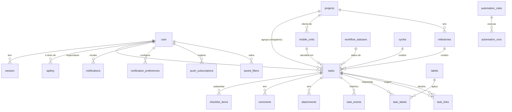

# ITC Tasks — Schema do banco

> Estado: **planejado** (17/10/2026). Este é o schema de partida do Módulo 00/03/04. Quando
> as migrações existirem, esta página passa a listar os arquivos reais de
> `src/db/migrations/` e o código abaixo vira referência histórica.

PostgreSQL 18.6 · Drizzle ORM 0.45.4 · driver `pg` 8.23.1. Todas as tabelas são classe ②
(estado da aplicação). Não há índice reconstruível separado: a busca usa a coluna gerada
`tasks.search` (ver `documentacao-itc-tasks.md` §4).

## Diagrama ER



## Tabelas do Better Auth

`user`, `session`, `account`, `verification` e `apikey` são **geradas pelo CLI do Better Auth**
(`npx @better-auth/cli generate --output src/db/schema/auth.ts`) a partir de
`src/server/auth.ts` — não escrever à mão. Campos adicionais declarados em `user.additionalFields`:

| Campo | Tipo | Padrão | Uso |
|---|---|---|---|
| `role` | `text` (`admin` \| `member`) | `member` | Plugin `admin` |
| `initials` | `text` (2 letras) | derivado do nome | Avatar |
| `theme` | `text` (`light` \| `dark`) | `light` | ADR-013 |
| `sidebarCollapsed` | `boolean` | `false` | Sidebar recolhida |
| `quietHoursStart` / `quietHoursEnd` | `text` `HH:mm` | `08:00` / `18:00` | Silêncio de push |
| `emailDigest` | `boolean` | `true` | Resumo diário |

## Schema de domínio (Drizzle)

Arquivos planejados: `src/db/schema/enums.ts`, `catalog.ts`, `tasks.ts`, `planning.ts`,
`automation.ts`, `notifications.ts`, reexportados por `src/db/schema/index.ts`.

```ts
// src/db/schema/enums.ts
import { pgEnum } from 'drizzle-orm/pg-core';

export const statusCategory = pgEnum('status_category', ['backlog', 'todo', 'in_progress', 'done']);
export const taskPriority   = pgEnum('task_priority', ['none', 'low', 'medium', 'high', 'urgent']);
export const projectKind    = pgEnum('project_kind', ['client', 'internal', 'project']); // ADR-044
export const actorKind      = pgEnum('actor_kind', ['user', 'agent', 'automation', 'system']);
export const linkKind       = pgEnum('link_kind', ['blocks', 'relates']);
export const cycleState     = pgEnum('cycle_state', ['planned', 'active', 'closed']);
export const templateKind   = pgEnum('template_kind', ['task', 'project']);
export const notificationEvent = pgEnum('notification_event', [
  'assigned', 'mentioned', 'commented', 'due_today', 'overdue', 'status_changed', 'agent_action',
]);
```

```ts
// src/db/schema/catalog.ts — cadastros (arquivados, nunca excluídos — ADR-018)
import { pgTable, uuid, text, integer, timestamp, uniqueIndex } from 'drizzle-orm/pg-core';
import { projectKind, statusCategory } from './enums';
import { user } from './auth';

const timestamps = {
  createdAt: timestamp('created_at', { withTimezone: true }).notNull().defaultNow(),
  updatedAt: timestamp('updated_at', { withTimezone: true }).notNull().defaultNow().$onUpdate(() => new Date()),
};

export const projects = pgTable('projects', {
  id: uuid('id').primaryKey().defaultRandom(),
  code: text('code').notNull(),                 // sigla 2–12 letras/dígitos, ex. BSBIA (ADR-044)
  name: text('name').notNull(),
  kind: projectKind('kind').notNull().default('client'),
  defaultAssigneeId: text('default_assignee_id').references(() => user.id),
  glpiEntity: text('glpi_entity'),
  archivedAt: timestamp('archived_at', { withTimezone: true }),
  ...timestamps,
}, (t) => [uniqueIndex('projects_code_uq').on(t.code)]);

export const mobileUnits = pgTable('mobile_units', {
  id: uuid('id').primaryKey().defaultRandom(),
  code: text('code').notNull(),                 // ex. UM-07
  model: text('model'),
  plate: text('plate'),
  base: text('base'),
  projectId: uuid('project_id').references(() => projects.id),
  archivedAt: timestamp('archived_at', { withTimezone: true }),
  ...timestamps,
}, (t) => [uniqueIndex('mobile_units_code_uq').on(t.code)]);

export const workflowStatuses = pgTable('workflow_statuses', {
  id: uuid('id').primaryKey().defaultRandom(),
  name: text('name').notNull(),
  category: statusCategory('category').notNull(),   // ADR-022
  position: integer('position').notNull(),
  archivedAt: timestamp('archived_at', { withTimezone: true }),
  ...timestamps,
});

export const labels = pgTable('labels', {
  id: uuid('id').primaryKey().defaultRandom(),
  name: text('name').notNull(),
  colorToken: text('color_token').notNull(),        // 'info' | 'sev-medium' | 'bordo' | 'accent' | 'ok' | 'warn'
  archivedAt: timestamp('archived_at', { withTimezone: true }),
  ...timestamps,
}, (t) => [uniqueIndex('labels_name_uq').on(t.name)]);
```

```ts
// src/db/schema/tasks.ts
import { pgTable, uuid, text, integer, boolean, date, timestamp, jsonb, index, primaryKey, customType } from 'drizzle-orm/pg-core';
import { sql } from 'drizzle-orm';
import { taskPriority, actorKind, linkKind } from './enums';
import { projects, mobileUnits, workflowStatuses, labels } from './catalog';
import { cycles, milestones } from './planning';
import { user, apikey } from './auth';

const tsvector = customType<{ data: string }>({ dataType: () => 'tsvector' });

export const tasks = pgTable('tasks', {
  id: uuid('id').primaryKey().defaultRandom(),
  number: integer('number').notNull().unique().default(sql`nextval('task_number_seq')`), // TI-<number>, ADR-021
  title: text('title').notNull(),
  descriptionJson: jsonb('description_json'),                     // documento Tiptap
  descriptionText: text('description_text').notNull().default(''),
  statusId: uuid('status_id').notNull().references(() => workflowStatuses.id),
  priority: taskPriority('priority').notNull().default('none'),
  projectId: uuid('project_id').notNull().references(() => projects.id),   // principal; todos em task_projects (ADR-045)
  mobileUnitId: uuid('mobile_unit_id').references(() => mobileUnits.id),
  glpiTicket: integer('glpi_ticket'),                             // ADR-023
  assigneeId: text('assignee_id').references(() => user.id),
  creatorId: text('creator_id').notNull().references(() => user.id),
  cycleId: uuid('cycle_id').references(() => cycles.id),
  milestoneId: uuid('milestone_id').references(() => milestones.id),
  dueDate: date('due_date'),
  position: text('position').notNull(),                           // índice fracionário (ADR-014)
  createdVia: actorKind('created_via').notNull().default('user'),
  completedAt: timestamp('completed_at', { withTimezone: true }),
  archivedAt: timestamp('archived_at', { withTimezone: true }),
  createdAt: timestamp('created_at', { withTimezone: true }).notNull().defaultNow(),
  updatedAt: timestamp('updated_at', { withTimezone: true }).notNull().defaultNow().$onUpdate(() => new Date()),
  search: tsvector('search').generatedAlwaysAs(
    sql`setweight(to_tsvector('portuguese', unaccent_immutable(coalesce(title, ''))), 'A') ||
        setweight(to_tsvector('portuguese', unaccent_immutable(coalesce(description_text, ''))), 'B')`,
  ),
}, (t) => [
  index('tasks_status_position_idx').on(t.statusId, t.position),
  index('tasks_assignee_due_idx').on(t.assigneeId, t.dueDate),
  index('tasks_project_idx').on(t.projectId),
  index('tasks_cycle_idx').on(t.cycleId),
  index('tasks_glpi_idx').on(t.glpiTicket),
  index('tasks_search_idx').using('gin', t.search),
]);

export const checklistItems = pgTable('checklist_items', {          // "Subtarefas" — ADR-019
  id: uuid('id').primaryKey().defaultRandom(),
  taskId: uuid('task_id').notNull().references(() => tasks.id, { onDelete: 'cascade' }),
  text: text('text').notNull(),
  done: boolean('done').notNull().default(false),
  assigneeId: text('assignee_id').references(() => user.id),
  position: text('position').notNull(),
  createdAt: timestamp('created_at', { withTimezone: true }).notNull().defaultNow(),
});

export const taskLinks = pgTable('task_links', {
  fromTaskId: uuid('from_task_id').notNull().references(() => tasks.id, { onDelete: 'cascade' }),
  toTaskId: uuid('to_task_id').notNull().references(() => tasks.id, { onDelete: 'cascade' }),
  kind: linkKind('kind').notNull(),            // 'blocks' = from bloqueia to
}, (t) => [primaryKey({ columns: [t.fromTaskId, t.toTaskId, t.kind] })]);

export const taskLabels = pgTable('task_labels', {
  taskId: uuid('task_id').notNull().references(() => tasks.id, { onDelete: 'cascade' }),
  labelId: uuid('label_id').notNull().references(() => labels.id),
}, (t) => [primaryKey({ columns: [t.taskId, t.labelId] })]);

export const comments = pgTable('comments', {
  id: uuid('id').primaryKey().defaultRandom(),
  taskId: uuid('task_id').notNull().references(() => tasks.id, { onDelete: 'cascade' }),
  authorId: text('author_id').notNull().references(() => user.id),
  actorKind: actorKind('actor_kind').notNull().default('user'),
  apiKeyId: text('api_key_id').references(() => apikey.id),
  bodyJson: jsonb('body_json').notNull(),
  bodyText: text('body_text').notNull(),
  mentions: text('mentions').array().notNull().default(sql`'{}'`),   // user ids
  createdAt: timestamp('created_at', { withTimezone: true }).notNull().defaultNow(),
  editedAt: timestamp('edited_at', { withTimezone: true }),
});

export const taskEvents = pgTable('task_events', {                   // só-inserção
  id: uuid('id').primaryKey().defaultRandom(),
  taskId: uuid('task_id').notNull().references(() => tasks.id, { onDelete: 'cascade' }),
  actorKind: actorKind('actor_kind').notNull(),
  actorUserId: text('actor_user_id').references(() => user.id),
  apiKeyId: text('api_key_id').references(() => apikey.id),
  automationRuleId: uuid('automation_rule_id'),
  type: text('type').notNull(),               // tipos no ADR-042, + 'projects_changed' | 'mobile_units_changed' (ADR-045) e 'commented' | 'comment_edited' | 'attachment_added' (ADR-048)
  payload: jsonb('payload').notNull().default(sql`'{}'::jsonb`),   // { field, from, to }
  createdAt: timestamp('created_at', { withTimezone: true }).notNull().defaultNow(),
}, (t) => [index('task_events_task_created_idx').on(t.taskId, t.createdAt)]);

export const attachments = pgTable('attachments', {                  // arquivo em UPLOADS_DIR — ADR-025
  id: uuid('id').primaryKey().defaultRandom(),
  taskId: uuid('task_id').notNull().references(() => tasks.id, { onDelete: 'cascade' }),
  uploaderId: text('uploader_id').notNull().references(() => user.id),
  fileName: text('file_name').notNull(),
  mimeType: text('mime_type').notNull(),
  sizeBytes: integer('size_bytes').notNull(),  // ≤ 26_214_400 (25 MB)
  storageKey: text('storage_key').notNull(),   // uuid do arquivo no volume
  createdAt: timestamp('created_at', { withTimezone: true }).notNull().defaultNow(),
});
```

```ts
// src/db/schema/planning.ts
import { pgTable, uuid, text, integer, date, timestamp, jsonb, uniqueIndex } from 'drizzle-orm/pg-core';
import { sql } from 'drizzle-orm';
import { cycleState, templateKind } from './enums';
import { projects } from './catalog';
import { user } from './auth';

export const cycles = pgTable('cycles', {
  id: uuid('id').primaryKey().defaultRandom(),
  number: integer('number').notNull().unique(),          // "Ciclo 42"
  startsOn: date('starts_on').notNull(),
  endsOn: date('ends_on').notNull(),
  state: cycleState('state').notNull().default('planned'),
  closedAt: timestamp('closed_at', { withTimezone: true }),
}, (t) => [uniqueIndex('cycles_one_active_uq').on(t.state).where(sql`state = 'active'`)]);

export const milestones = pgTable('milestones', {
  id: uuid('id').primaryKey().defaultRandom(),
  name: text('name').notNull(),
  description: text('description'),
  projectId: uuid('project_id').notNull().references(() => projects.id),
  dueOn: date('due_on'),
  closedAt: timestamp('closed_at', { withTimezone: true }),
  createdAt: timestamp('created_at', { withTimezone: true }).notNull().defaultNow(),
});

export const templates = pgTable('templates', {
  id: uuid('id').primaryKey().defaultRandom(),
  name: text('name').notNull(),
  kind: templateKind('kind').notNull(),
  payload: jsonb('payload').notNull(),         // validado por templatePayloadSchema (Zod)
  usageCount: integer('usage_count').notNull().default(0),
  createdById: text('created_by_id').notNull().references(() => user.id),
  createdAt: timestamp('created_at', { withTimezone: true }).notNull().defaultNow(),
});

export const savedFilters = pgTable('saved_filters', {
  id: uuid('id').primaryKey().defaultRandom(),
  userId: text('user_id').notNull().references(() => user.id, { onDelete: 'cascade' }),
  name: text('name').notNull(),
  view: text('view').notNull(),                // 'kanban' | 'list' | 'calendar'
  filters: jsonb('filters').notNull(),
  createdAt: timestamp('created_at', { withTimezone: true }).notNull().defaultNow(),
});
```

```ts
// src/db/schema/automation.ts
import { pgTable, uuid, text, integer, boolean, timestamp, jsonb } from 'drizzle-orm/pg-core';
import { tasks } from './tasks';

export const automationRules = pgTable('automation_rules', {
  id: uuid('id').primaryKey().defaultRandom(),
  name: text('name').notNull(),
  enabled: boolean('enabled').notNull().default(true),
  trigger: text('trigger').notNull(),          // 'task.created' | 'task.status_changed' | 'task.assigned' | 'task.priority_changed' | 'task.overdue'
  conditions: jsonb('conditions').notNull(),   // automationConditionsSchema
  actions: jsonb('actions').notNull(),         // automationActionsSchema
  runCount: integer('run_count').notNull().default(0),
  lastRunAt: timestamp('last_run_at', { withTimezone: true }),
  createdAt: timestamp('created_at', { withTimezone: true }).notNull().defaultNow(),
});

export const automationRuns = pgTable('automation_runs', {
  id: uuid('id').primaryKey().defaultRandom(),
  ruleId: uuid('rule_id').notNull().references(() => automationRules.id, { onDelete: 'cascade' }),
  taskId: uuid('task_id').references(() => tasks.id, { onDelete: 'set null' }),
  ok: boolean('ok').notNull(),
  error: text('error'),
  createdAt: timestamp('created_at', { withTimezone: true }).notNull().defaultNow(),
});
```

```ts
// src/db/schema/notifications.ts
import { pgTable, uuid, text, boolean, timestamp, jsonb, index, primaryKey, uniqueIndex } from 'drizzle-orm/pg-core';
import { notificationEvent } from './enums';
import { tasks } from './tasks';
import { user } from './auth';

export const notifications = pgTable('notifications', {
  id: uuid('id').primaryKey().defaultRandom(),
  userId: text('user_id').notNull().references(() => user.id, { onDelete: 'cascade' }),
  event: notificationEvent('event').notNull(),
  taskId: uuid('task_id').references(() => tasks.id, { onDelete: 'cascade' }),
  actorLabel: text('actor_label').notNull(),   // "Ana", "Triagem GLPI", "Prazo"
  data: jsonb('data').notNull(),               // trecho do comentário, status de/para
  readAt: timestamp('read_at', { withTimezone: true }),
  createdAt: timestamp('created_at', { withTimezone: true }).notNull().defaultNow(),
}, (t) => [index('notifications_user_unread_idx').on(t.userId, t.readAt, t.createdAt)]);

export const notificationPreferences = pgTable('notification_preferences', {
  userId: text('user_id').notNull().references(() => user.id, { onDelete: 'cascade' }),
  event: notificationEvent('event').notNull(),
  inApp: boolean('in_app').notNull().default(true),
  push: boolean('push').notNull().default(false),
  email: boolean('email').notNull().default(false),
}, (t) => [primaryKey({ columns: [t.userId, t.event] })]);

export const pushSubscriptions = pgTable('push_subscriptions', {
  id: uuid('id').primaryKey().defaultRandom(),
  userId: text('user_id').notNull().references(() => user.id, { onDelete: 'cascade' }),
  endpoint: text('endpoint').notNull(),
  p256dh: text('p256dh').notNull(),
  auth: text('auth').notNull(),
  userAgent: text('user_agent'),
  createdAt: timestamp('created_at', { withTimezone: true }).notNull().defaultNow(),
  lastUsedAt: timestamp('last_used_at', { withTimezone: true }),
}, (t) => [uniqueIndex('push_subscriptions_endpoint_uq').on(t.endpoint)]);
```

## SQL fora do Drizzle (primeira migração customizada)

O Drizzle não gera estes objetos; eles entram numa migração `--custom` do drizzle-kit no Módulo 00:

```sql
CREATE EXTENSION IF NOT EXISTS unaccent;
-- unaccent() não é IMMUTABLE; a coluna gerada exige uma função imutável
CREATE OR REPLACE FUNCTION unaccent_immutable(text) RETURNS text
  LANGUAGE sql IMMUTABLE PARALLEL SAFE STRICT
  AS $$ SELECT public.unaccent('public.unaccent'::regdictionary, $1) $$;
CREATE SEQUENCE IF NOT EXISTS task_number_seq START 1;
```

## Regras de negócio no schema

- **`tasks.position` e `checklist_items.position`** — `text COLLATE "C"` (implementado no Módulo 04, ADR-042): as chaves do índice fracionário comparam por byte.

- **`tasks.project_id NOT NULL`** — a regra principal do produto existe também no banco: é o projeto principal, sempre presente em `task_projects` (ADR-045).
- **`task_projects` / `task_mobile_units`** (Módulo 04, migração `0007`) — PK `(task_id, project_id)` / `(task_id, mobile_unit_id)`, `ON DELETE cascade` na tarefa; fonte de verdade dos vínculos com Projetos/Clientes e UMs. `default_assignee_id` de `projects` fica sem uso (ADR-045); `mobile_units.project_id` é exigido pelo Zod (ADR-044).
- **`tasks.completed_at`** — preenchido pelo service quando o status entra em categoria `done`; limpo ao sair (ADR-022).
- **`cycles_one_active_uq`** — índice único parcial: no máximo um ciclo `active`.
- **`task_events`** — só-inserção; nenhum service expõe update/delete.
- **`labels.color_token`** — guarda o nome do token, nunca hex (Design System, princípio 5).
- **`notification_preferences`** — o seed cria as 7 linhas por usuário com os padrões da tela de Preferências.

## Seed planejado (`src/db/seed.ts`)

| Dado | Valores |
|---|---|
| Status | Backlog (`backlog`), A fazer (`todo`), Em andamento (`in_progress`), Concluído (`done`) |
| Etiquetas | rede (`info`), hardware (`sev-medium`), segurança (`bordo`), campo (`accent`) |
| Automações | as 6 regras da tela Automações; "Etiquetar tarefas de UM" desligada |
| Admin | `SEED_ADMIN_EMAIL` / `SEED_ADMIN_PASSWORD`, `role = 'admin'` |
| Projeto | "A classificar" (`ACL`, interno) para a migração do Windshift |
